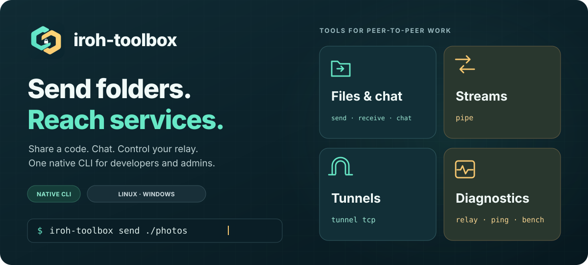
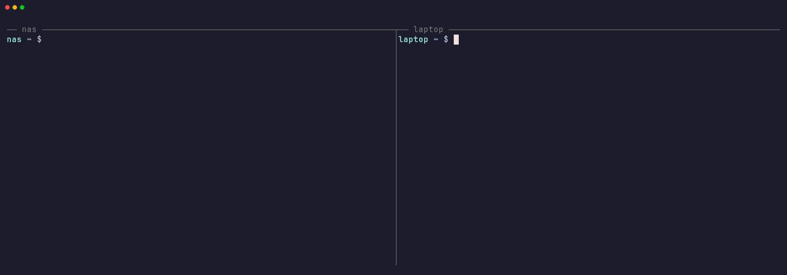

<p align="center">
  
</p>

<p align="center">
  <a href="https://github.com/pytgaen/iroh-toolbox/actions/workflows/ci.yml"></a>
  <a href="docs/index.md"></a>
  <a href="LICENSE.txt"></a>
  <a href="docs/guides/installation.md"></a>
</p>

<p align="center">
  <strong>Send a folder. Start a chat. Reach a remote service.</strong>
</p>

<p align="center">
  <a href="docs/index.md">Documentation</a> ·
  <a href="#quick-start">Quick start</a> ·
  <a href="https://github.com/pytgaen/iroh-toolbox/releases">Releases</a> ·
  <a href="CHANGELOG.md">Changelog</a> ·
  <a href="CONTRIBUTING.md">Contributing</a>
</p>

**Send files and chat with a one-use code, pair your machines once, and reach
their services from your terminal.** One native executable for developers and
administrators; no prior knowledge of iroh is needed.

> [!WARNING]
> The pairing protocol and the `spake2` crate it relies on have not been
> audited independently. The maintainer review and its mitigations are in
> [`notes/spake2-review.md`](notes/spake2-review.md); an outside review is
> planned before 1.0. Do not rely on iroh-toolbox where a failure would be
> serious.

- **Share a code, send a folder.** Files travel over iroh and are verified with
  BLAKE3 before publication. Existing destination names are listed and replaced
  only after confirmation.
- **Chat and exchange files.** Start a chat with a code or with a paired
  machine, and accept each file offer explicitly.
- **Pair your machines once.** Give each machine a name, then send files to its
  inbox, share a folder or chat without a code. Tunnels, pipes and these
  services accept paired machines only, and each tunnel or pipe server names
  whom it serves with `--allow`.
- **Reach your services.** Forward TCP ports for HTTP, SSH or another
  application between paired machines, or browse a folder of one in your
  browser without running a web server.
- **Choose your route.** End-to-end encryption, direct connections when reachable,
  public iroh relays by default, or a relay you control.



Pair once with a code, then reach a machine by name.
[Read the captured transcript](docs/assets/pair-tunnel-demo.txt).

## Install

Linux:

```sh
curl -fsSL https://github.com/pytgaen/iroh-toolbox/releases/latest/download/install.sh | sh
```

Windows (PowerShell):

```powershell
irm https://github.com/pytgaen/iroh-toolbox/releases/latest/download/install.ps1 | iex
```

The script downloads the archive for your platform from the latest release,
checks it against the release's SHA-256 manifest, and installs the executable in
`~/.local/bin`, or on Windows in `%LOCALAPPDATA%\Programs\iroh-toolbox`, added to
your user PATH. No Rust or Python installation is needed. See
[installation](docs/guides/installation.md) for options, reading the script before
running it, updates and uninstallation.

### Release archives

To install by hand, download the archive for your platform and the
`iroh-toolbox-vX.Y.Z-sha256sums.txt` manifest from
[Releases](https://github.com/pytgaen/iroh-toolbox/releases). CI builds and tests
each archive on its native platform for every tagged release.

| Platform | Release archive |
| --- | --- |
| Linux x86_64 | `iroh-toolbox-vX.Y.Z-x86_64-unknown-linux-musl.tar.gz` |
| Windows x86_64 | `iroh-toolbox-vX.Y.Z-x86_64-pc-windows-msvc.zip` |

Each archive contains the executable, an offline quick start, build provenance
and licenses. See [installation](docs/guides/installation.md#release-archives)
for verification and PATH setup.

### Build from source

With Rust 1.99 or newer ([rustup](https://rustup.rs/)) and your platform's
[C/C++ build tools](docs/guides/installation.md#build-from-source):

```sh
git clone https://github.com/pytgaen/iroh-toolbox
cd iroh-toolbox
cargo install --path . --locked
```

This installs `iroh-toolbox` in Cargo's bin directory, with every feature. This
is the way to install it on macOS: no prebuilt archive is published and CI does
not test macOS yet.

## Quick start

Both peers need the executable. Keep the sender running until the receiver
finishes. No private relay or token is required.

### Send a folder with a code

Choose a non-empty `my-folder` on A, then run:

```sh
# Machine A
iroh-toolbox send ./my-folder
```

A prints a one-use code of six words. Type the **complete code** on B at the
prompt (echo off, kept out of the process list):

```sh
# Machine B — type A's actual code at the "Code:" prompt
iroh-toolbox receive code: --output ./received
```

On B, **`received my-folder → …; BLAKE3 verified`** confirms publication in
`received/my-folder/`. Open a received file to check its content.

The code needs no server of yours: the machines meet through iroh's relays,
authenticate with SPAKE2, and only the receiver that used the code may download.
Each machine also shows a 6-digit confirmation number: read yours to the other
person and type theirs before anything is sent. `--no-verify` on both machines
skips it. See the [pairing protocol](docs/reference/pairing-protocol.md).

See the [step-by-step quick start](docs/guides/quick-start.md) for a sample
folder and expected results, and the [file guide](docs/guides/files.md) for
replacement options, temporary storage and filesystem requirements.

### Chat, then offer a file

```sh
# Machine A — keep this running
iroh-toolbox chat serve

# Machine B — type A's complete code at the prompt
iroh-toolbox chat connect code:
```

The code admits one participant: the first to use it. After both terminals
report `Chat ready; admission: code.`, type a message and press Enter.
In A's chat, `/send ./my-folder` offers a folder; B accepts it with
`/receive ./received`. Chat continues during the transfer. Use `/quit` to leave.
The [chat guide](docs/guides/chat.md) covers file acceptance, identity checks
and timeouts.

### Pair two machines

Tunnels and pipes work only between paired machines, which can also exchange
files and chat without a code. Pair them once:

```sh
# Machine A — the one that runs the service
iroh-toolbox pair

# Machine B — type A's complete code at the prompt
iroh-toolbox pair code:
```

Each screen shows its own 6-digit number: read yours to the other person, and
type the one they read to you.
Pairing asks nothing else and starts no service.

A announces its machine name: its hostname by default, or the name set with
`iroh-toolbox id rename NAME`. B can give it another local name with `--name`,
and reports **`Paired with nas (machine …)`**. `iroh-toolbox peers` lists
paired machines with their short key and pairing date; `peers rename` and
`peers rm` change or remove them. See [machine pairing](docs/reference/peers.md).

### Send between paired machines

```sh
# Machine B (laptop) — an inbox, until Ctrl-C
iroh-toolbox receive --inbox --output ./received

# Machine A (nas)
iroh-toolbox send ./my-folder peer:laptop
```

An inbox never replaces existing files. To let other machines fetch instead,
run `send ./my-folder --peers-only` (add `--share` for several receivers) on A
and `receive peer:nas` on each of them. For a chat without a code, run
`chat serve --peers-only` on A and `chat connect peer:nas` on B. See the
[file guide](docs/guides/files.md#send-to-an-inbox).

### Reach a remote web server

Machine A has a service listening on `127.0.0.1:3000`:

```sh
iroh-toolbox tunnel tcp serve --to 127.0.0.1:3000 --allow laptop
```

On machine B, name the paired machine and open a local port:

```sh
iroh-toolbox tunnel tcp connect peer:nas --bind 127.0.0.1:8080
```

Open `http://127.0.0.1:8080` on B to reach A's service. The listening message confirms only the local port. A reports when the
destination TCP service connects; the page response confirms application access.
Both commands remain running and accept multiple connections. See [tunnels](docs/guides/tunnels.md)
for SSH and [binary streams](docs/guides/streams.md) for stdin/stdout transport
with `pipe serve` and `pipe connect peer:nas`.

Without a web server, A can serve a folder read-only, or a static site with
`--site`:

```sh
iroh-toolbox tunnel http serve ./my-folder --allow laptop
```

On B, `iroh-toolbox tunnel http connect peer:nas` prints the URL to open. See
[browse a folder](docs/guides/tunnels.md#browse-a-folder).

A tunnel server must name who it serves: `--allow NAME` for some paired
machines, or `--allow all` for every one of them. A tunnel keeps its address across restarts. To run several on one
machine, give each a slot name: `--slot ssh --allow laptop` on A,
`peer:nas/ssh` on B. See [machine identity and slots](docs/reference/slots.md).

Without a relay, fix the server's UDP port with `--direct-only --port 7777` on
A, and give B the address A prints: `--direct-only --addr 192.168.1.10:7777`.
Pairing still needs a relay once.

Several TCP services can share one slot: name them on A
(`--to web=127.0.0.1:3000 --to db=127.0.0.1:5432`), and B opens the whole group
with `tunnel tcp connect peer:nas/SLOT`, one service with
`peer:nas/SLOT/web`, or moves one with `--bind db=127.0.0.1:15432`. See
[several services on one slot](docs/guides/tunnels.md#several-services-on-one-slot).

## Use your own relay

This is optional. Without a relay URL, the toolbox uses iroh's production public
relays and can switch to a direct connection. Selecting a custom relay replaces
that public set; its access token is never sent to public relays. `--relay-only`
forces relayed data through the selected custom relay or the default public set.

To deploy one, follow the [Docker Compose relay guide](docs/guides/private-relay.md):
server and DNS prerequisites, HTTPS with Caddy, shared-token authentication, and
checks between two machines.

Set these variables on **both machines** using a token accepted by your relay.

Linux / POSIX shell:

```sh
export IROH_TOOLBOX_RELAY="https://relay.example.com"
export IROH_TOOLBOX_TOKEN="your-shared-token"
```

Windows / PowerShell:

```powershell
$env:IROH_TOOLBOX_RELAY = "https://relay.example.com"
$env:IROH_TOOLBOX_TOKEN = "your-shared-token"
```

Verify registration without a second peer:

```sh
iroh-toolbox relay check
```

The token is sent as `Authorization: Bearer …`; it is never embedded in tickets
or the relay URL. Reverse proxies must permit the unauthenticated iroh probes
and forward WebSocket registration with its authorization header. The
[private-relay guide](docs/guides/private-relay.md) covers those routes and
[TOML configuration](docs/reference/configuration.md) covers precedence.

## What you can do

| Goal | Command | What you get |
| --- | --- | --- |
| Move files or folders | `send` / `receive` | One-use code, or an inbox, offer or share between paired machines; BLAKE3 verification, collision protection |
| Chat and offer files | `chat serve/connect` | Private two-peer conversation started with a code or between paired machines, explicit file acceptance |
| Pair your machines | `pair`, `peers` | Named, revocable trust between your machines; each server narrows it with `--allow` |
| Carry binary data | `pipe serve/connect` | stdin/stdout transport between paired machines, with independent closure of each direction |
| Reach a remote service | `tunnel tcp serve/connect` | Local TCP access to a web server, SSH, or another TCP service of a paired machine |
| Browse a remote folder | `tunnel http serve/connect` | A paired machine's folder or static site in your browser, read-only, without a web server |
| Check your relay | `relay check` | Actual registration, authentication errors, JSON output |
| Observe the path | `ping serve/connect` | Peer RTT and direct/relay path information |
| Measure throughput | `bench serve/connect` | Upload/download measurements between two peers |
| Inspect a ticket | `ticket inspect` | Offline decoding of the tickets printed by `ping` and `bench` |
| Manage this machine | `id` | Name and machine key, identity rotation after an incident |

## Documentation

| Start here | Go deeper |
| --- | --- |
| [Installation](docs/guides/installation.md) · [Quick start](docs/guides/quick-start.md) | [CLI reference](docs/reference/cli.md) · [Configuration](docs/reference/configuration.md) |
| [Files](docs/guides/files.md) · [Chat](docs/guides/chat.md) · [Streams](docs/guides/streams.md) · [Tunnels](docs/guides/tunnels.md) | [Security model](docs/reference/security.md) · [Compatibility & limits](docs/reference/compatibility.md) |
| [Diagnostics & benchmarks](docs/guides/diagnostics.md) | [Connection paths](docs/reference/connection-paths.md) · [Troubleshooting](docs/reference/troubleshooting.md) |

Browse the documentation at <https://pytgaen.github.io/iroh-toolbox/>, with
search, light/dark themes, and copyable examples.

## Security and project status

**Pre-1.0:** command behavior may evolve. Nothing gives access to your data or
services without authentication:

- **Files and chat** start with a one-use code: SPAKE2 authenticates both
  machines, and only the machine that used the code is served. Between paired
  machines, they need no code.
- **Tunnels, pipes, inboxes, offers and chats by name** accept only machines
  you paired with `pair`. Tunnel and pipe servers start only with `--allow NAME`
  or `--allow all`; the other servers accept all of them unless `--allow`
  narrows them. Every connection is checked with a signature from the
  client's machine key: knowing a server's endpoint ID, as a relay does, is not
  enough.
- **`ping` and `bench`** expose measurements, not data. By default they accept
  anyone who reaches them (ticket or slot), a removed peer included; with
  `--peers-only` (or `--allow NAME`) they serve paired machines only.

The relay token controls relay access, not access to your services. A
confirmation number is always compared when pairing. Keep authentication
enabled on forwarded services: an admitted machine reaches them as a local
client would. After losing a machine, remove it with `peers rm` on the others,
then run `id rotate --address` there so it cannot disrupt their slots, and
pair again; `peers rm` alone does not stop open `ping`/`bench` servers, end an
open session or revoke an unused chat code. A chat code admits whoever uses it
first: restart `chat serve` to replace a disclosed code, or use
`chat serve --allow NAME` (or `--peers-only`), which creates none. See the
[security model](docs/reference/security.md).

Transfers require temporary disk space and a destination filesystem supporting
hard links. Empty directories, permissions, and timestamps are not preserved.
An interrupted reception resumes with the same command while the sender runs;
chat receptions are not resumable. Publication of a directory is not atomic as a
whole. iroh-toolbox uses its own protocols over iroh and does not exchange data
with other iroh tools; see [compatibility](docs/reference/compatibility.md).

CI tests every change on Linux and Windows, and checks formatting, Clippy,
the minimum Rust version, dependency advisories and licenses, the documentation,
and the release archives.

## Contributing

Bug reports, focused fixes, and documentation improvements are welcome. Include
your OS, command version, and observed connection path when reporting a problem;
remove tokens and sensitive tickets from examples.

Development tasks use [mise](https://mise.jdx.dev/):

```sh
mise run test
mise run lint
mise run docs:serve   # preview the documentation
```

Read [CONTRIBUTING.md](CONTRIBUTING.md) for development, verification, and releases.

## License

[Apache-2.0](LICENSE.txt), for the sources and every build. Copyright 2026 pytgaen.
Pairing codes use the EFF Large Wordlist (CC BY 3.0); see [NOTICE](NOTICE) and the
[license reference](docs/reference/license.md).
