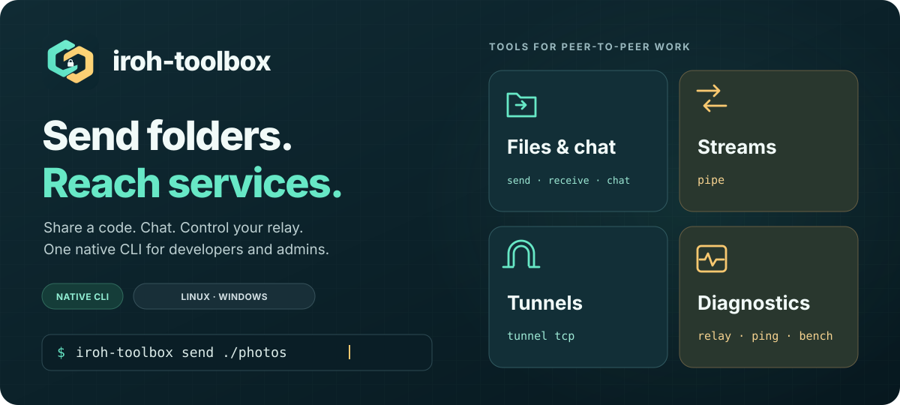
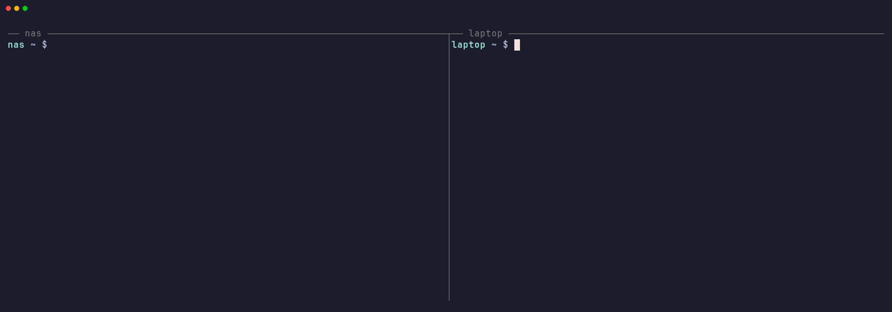

# Send a folder. Start a chat. Reach your services.

{ .hero }

**Share a one-use code to send a folder or start a private chat. Reach a remote
service through a local port.** One native CLI for developers and administrators;
no prior knowledge of iroh is needed. Connections are encrypted end to end,
with public iroh relays by default or a relay you control.

[Install](guides/installation.md){ .md-button .md-button--primary }
[Get your first result](guides/quick-start.md){ .md-button }

## Install and send a folder

[Run the install script](guides/installation.md#install-script) or
[build from source](guides/installation.md#build-from-source). Both peers need the
executable. Choose a non-empty `my-folder` on A:

```sh title="Machine A — keep this running"
iroh-toolbox send ./my-folder
```

Type the complete six-word code A prints on B, at the prompt (echo off, kept
out of the process list):

```sh title="Machine B — type A's actual code at the prompt"
iroh-toolbox receive code: --output ./received
```

On B, `received my-folder → …; BLAKE3 verified` confirms publication in
`received/my-folder/`. Open a received file to check its content. Existing names
are listed and replaced only after confirmation. The machines meet through
iroh's relays without any server of yours, authenticate with the code, then
transfer over iroh. Each machine first shows a 6-digit number to compare with
the other person; `--no-verify` on both machines skips it.

Only the machine that types the code is served. The
[quick start](guides/quick-start.md) includes sample files and expected results.
No private relay or token is required. You can select the
[same custom relay](guides/private-relay.md) on both peers.

## Chat and exchange files

Run `iroh-toolbox chat serve` on A, then `iroh-toolbox chat connect code:`
on B and type A's complete code at the prompt. After both terminals report
`Chat ready; admission: code.`, type a message and press Enter. A can offer
`/send ./my-folder`; B accepts with `/receive ./received`. Use `/quit` to leave.
Paired machines can also join by name with `chat connect peer:NAME`. See
[chat and file offers](guides/chat.md).

## Pair two machines, then reach a web service

Tunnels and pipes serve only machines you paired; paired machines can also send
files and chat without a code. Pair once, in two interactive terminals, and
compare the 6-digit number:

```sh title="Machine A — the one that runs the service"
iroh-toolbox pair
```

```sh title="Machine B — type A's complete code at the prompt"
iroh-toolbox pair code:
```

Both machines report `Paired with NAME (machine …)`. A tunnel or pipe server
names whom it serves with `--allow NAME` (or `--allow all`). A must have a web service
listening on `127.0.0.1:3000`:

```sh title="Machine A"
iroh-toolbox tunnel tcp serve --to 127.0.0.1:3000 --allow laptop
```

```sh title="Machine B — A's name is in `iroh-toolbox peers`"
iroh-toolbox tunnel tcp connect peer:nas --bind 127.0.0.1:8080
```

Open `http://127.0.0.1:8080` on B and check the expected page. The local listening
message alone does not confirm remote access. Keep both commands running.
Without a web service, `tunnel http serve ./my-folder --allow laptop` on A serves a folder
read-only, and `tunnel http connect peer:nas` on B prints the URL to open.
See [machine pairing](reference/peers.md) and the
[tunnel guide](guides/tunnels.md) for slots, state messages and failures.



[Captured transcript](assets/pair-tunnel-demo.txt).

## Choose a tool

<div class="grid cards" markdown>

- **Send a folder or start a chat**

    Meet with a one-use code, or send to a paired machine by name. Verify
    received files with BLAKE3, or accept a file offer inside a private chat.

    [File transfers](guides/files.md) · [Chat & file offers](guides/chat.md)

- **Carry a stream or service**

    Exchange binary stdin/stdout, reach a remote web server through a local
    TCP port, or browse a remote folder, between machines you paired.

    [Streams](guides/streams.md) · [Tunnels](guides/tunnels.md)

- **Understand the connection**

    Check relay registration, measure RTT and throughput, and observe direct or
    relay paths.

    [Diagnostics & benchmarks](guides/diagnostics.md)

- **Use your own relay**

    Deploy a private relay with Docker Compose and HTTPS, configure its bearer
    token, and verify an exchange through it.

    [Private relays](guides/private-relay.md)

</div>

## Find the right command

| Goal | Command | Guide |
| --- | --- | --- |
| Send files or folders | `send` / `receive` | [Transfers](guides/files.md) |
| Send to or fetch from a paired machine | `receive --inbox`, `send PATH peer:NAME`, `send --peers-only` | [Transfers](guides/files.md#send-to-an-inbox) |
| Chat and accept file offers | `chat serve/connect` | [Chat](guides/chat.md) |
| Pair two machines once | `pair`, `peers`, `id` | [Machine pairing](reference/peers.md) |
| Exchange stdin/stdout | `pipe serve/connect` | [Streams](guides/streams.md) |
| Reach a remote TCP service | `tunnel tcp serve/connect` | [Tunnels](guides/tunnels.md) |
| Browse a remote folder or site | `tunnel http serve/connect` | [Tunnels](guides/tunnels.md#browse-a-folder) |
| Verify relay registration | `relay check` | [Diagnostics](guides/diagnostics.md) |
| Measure peer RTT | `ping serve/connect` | [Diagnostics](guides/diagnostics.md) |
| Measure upload/download throughput | `bench serve/connect` | [Diagnostics](guides/diagnostics.md) |
| Inspect a ticket without networking | `ticket inspect` | [CLI reference](reference/cli.md) |

## Conditions and limits

Connections are encrypted end to end. Files and chat serve the machine that
used the one-use code, or a paired machine; tunnels and pipes serve only paired
machines. A tunnel or pipe server starts only with `--allow NAME` or `--allow all`;
other peer services accept every paired machine unless `--allow NAME` narrows
them, which also opens no code. A chat code admits its first holder:
use `chat serve --allow NAME` or `--peers-only` to open no code. `ping` and `bench` expose
measurements to anyone who reaches them (ticket or slot) unless started with
`--peers-only`, which serves paired machines only. The relay token controls
access to the relay, not to your services: keep authentication enabled on
forwarded services, since an admitted machine reaches them like a local client.

Transfers need temporary disk space and a destination filesystem supporting
hard links. An interrupted reception resumes with the same command while the
sender runs; empty directories, permissions and timestamps are not preserved. A directory's publication is not atomic as a whole.

Exchanges between separate machines and networks remain to be validated in the field.

iroh-toolbox is pre-1.0. Read the [security model](reference/security.md),
[compatibility limits](reference/compatibility.md), and
[changelog](maintainers/changelog.md) before relying on it for a new workflow.
