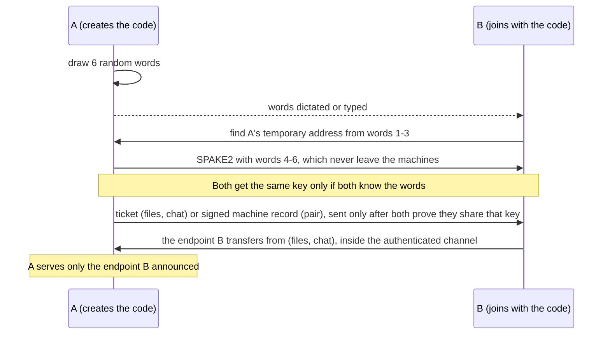

# Security model

!!! warning "No independent audit"

    The pairing protocol and the `spake2` crate it relies on have not been
    audited independently. The maintainer review and its mitigations are in
    [`notes/spake2-review.md`](https://github.com/pytgaen/iroh-toolbox/blob/main/notes/spake2-review.md);
    an outside review is planned before 1.0. Do not rely on iroh-toolbox where a
    failure would be serious.

No command gives access to your data or services to a machine that has not
authenticated. What each command serves, and to whom:

| Command | Who is served | How it is authenticated |
| --- | --- | --- |
| `send` / `receive`, `chat serve` / `chat connect` with a code | The machine that used the one-use code | Code (SPAKE2) and, unless `--no-verify`, a confirmation number |
| `receive --inbox`, `send PATH --peers-only`, the peer path of `chat serve`, `tunnel tcp`, `tunnel http`, `pipe` | [Paired machines](peers.md), on a running server's slot. `tunnel tcp`, `tunnel http` and `pipe` serve only the machines named by `--allow NAME` or, with `--allow all`, every paired machine; the other servers accept every paired machine unless `--allow` narrows them | A signature from each machine key on every connection |
| `ping`, `bench` | Anyone who reaches the server (ticket or slot), removed peers included. With `--peers-only`: paired machines, narrowed with `--allow` | The server only; with `--peers-only`, the client's machine key too |
| `relay check`, `ticket inspect`, `id`, `peers` | Local commands | Not applicable |

Peer traffic is always encrypted end to end by iroh. Machine addresses are
internal: `pair` exchanges them and the peer book stores them, and no command
prints or accepts them. `peers rm` refuses the next connection of a removed
machine to every peer service (tunnels, pipes, files, chat and `--peers-only`
ping/bench); it neither ends open sessions nor revokes a chat code. Open
ping/bench servers stop serving a former peer only after `id rotate --address`.

## Codes (6 words)

`send`, `chat serve` and `pair` create a one-use code of random words; the
other machine joins with `receive code:WORDS`, `chat connect code:WORDS` or
`pair code:WORDS`. A code is short enough to be dictated, and what follows
travels inside an encrypted channel instead of being copied.

- **Words 1–3** locate A's temporary rendezvous endpoint (about 470 billion
  addresses). They are treated as public: anyone who knows them derives the
  same endpoint ID, and the relay and DNS operators see it. A's rendezvous
  endpoint is relay-only (no UDP socket), so a third party that connects to it
  learns none of A's IP addresses; the connection only reaches A through the
  relay. Knowing only these words lets someone make the attempt fail, nothing
  more. `--code-words` never lengthens this part.
- **Words 4–6** (and any added with `--code-words`) are the SPAKE2 password. They are never sent; SPAKE2 proves that
  both machines know them without revealing them, and binds the result to the
  iroh identity of B's temporary pairing endpoint.
- **One attempt per code.** A guess succeeds with probability about 2⁻³⁸;
  right or wrong, it closes the code. A recorded exchange does not let anyone
  test passwords offline.
- After the exchange, the sender and the chat creator accept only the endpoint
  B announced inside the authenticated channel, covered by both `done` MACs.
  For `send`, every other connection is refused, including one from the
  endpoint B paired from, so a stranger who learns the endpoint ID can neither
  download nor take the receiver's place.

No mailbox or server operated by this project is involved. With public relays,
A publishes its temporary rendezvous address through n0's DNS: the record holds
A's relay URL, never an IP address. B's side is relay-only as well: B pairs
from a temporary endpoint without UDP sockets, and announces the endpoint it
transfers from only after SPAKE2 succeeded. Someone who registers the
rendezvous ID before A (which requires knowing words 1–3) and accepts B's
connection learns B's temporary endpoint ID, its home relay and the fact that
a pairing of that kind was attempted, but no IP address and not B's transfer
endpoint; it cannot derive words 4–6 from them. See the
[pairing protocol](pairing-protocol.md) for the exact messages and deadlines.

## Confirmation number (6 digits)

By default on `send`, `receive`, `chat serve` and `chat connect`, and
always with `pair`, each machine shows its own 6-digit number and asks for the
other machine's. Nothing is delivered until each person has typed the number
the other person read to them, over a channel the attacker cannot alter: a voice
they recognize, or in person. The numbers are not secret; they are read aloud.

Typing the other number, instead of answering `yes`, makes the check
unavoidable: a screen shows only its own number, so nobody can confirm without
actually exchanging numbers with the other person. Each machine checks the
number typed on it by itself; it trusts no message from the network for that.

It helps when the code may have been seen by someone else (shared chat, screen,
overheard call). Whoever used the code instead of B, or sits between A and B
with the same code, ends up in a different session, so the numbers read aloud
are not the ones each machine expects, or B has none. The attacker cannot force
them to match: neither machine chooses the numbers alone (see the [pairing protocol](pairing-protocol.md#confirmation-number)).

It does not help if the attacker controls the only channel between the two
people: they can replace the code with their own and rewrite the numbers. Nor
does it help if the code came from the attacker. If the code already travelled
over a channel nobody else can read or alter, the number adds nothing for files
and chat: `--no-verify` on both machines skips it. For `pair` it is required anyway, because pairing records a trusted
machine that may join your peer services, and both people are at their
machines. In `chat serve`, the number applies to the code only: a paired
machine that joins through the peer path proves its machine key instead.

With `--no-verify`, whoever uses the code first is served, and nothing tells the
creator if the code was seen by someone else; `send` and `chat serve` print a
note before the code. Each machine keeps its own setting: a machine started with
`--no-verify` refuses a partner that asks for the number, and the other way
round, so an attacker holding the code cannot switch it off.

The confirmation needs interactive terminals on both machines; without one, and
without `--no-verify`, the command fails before any network activity. Spaces in the
typed number are optional. Three wrong numbers (for typing mistakes: the
expected number never changes), an empty answer, an interruption or the
deadline cancel the pairing on both sides.

## What none of them prove

A code does not prove who operates a machine:

- **To the machine that joins:** it reaches a machine that knows the code:
  normally its creator, or anyone who saw it on the way. Anyone can create a
  code and send it under another name. Pairing then succeeds, and the
  confirmation numbers match, because both ends are genuine. The tool only
  knows that each person typed the other machine's number, not whom they heard
  it from.
- **To the machine that created it:** the other machine knows the code. That is
  the person it was given to, or anyone who saw it on the way.

Nobody can pick or guess the code of someone else's session: it is drawn at
random by the creating machine. Trust therefore comes from the channel the code
travels through: a voice you recognize, a messenger account you trust, or in
person.

**Pairing itself proves two things** that a code alone does not: each machine
holds the machine key it announced (the record is signed over this session), and
both people exchanged the confirmation numbers. It does not prove who the person
at the other machine is, and the announced name is only a suggestion: the
machine key is the identity. Pairing starts no service, but a paired machine
can join every peer service you run whose `--allow` does not exclude it. If you
paired with an impostor, remove it with `peers rm`: running servers refuse its
next connection.

## Codes, pairings and sessions

Three different things decide who takes part, and each is revoked differently:

| | What it is | Ends with |
| --- | --- | --- |
| **Code possession** | Whoever completes the code exchange first is admitted, paired or not. Single-use limits the code to one admission, not to the intended participant | Its first use, its deadline, or stopping the command. Not `peers rm`. A chat started with `--allow` creates none |
| **Machine pairing** | A durable entry in the peer book. On every peer connection the client signs with its machine key, and the server reads its book and its own `--allow` | `peers rm`, from the machine's next connection |
| **Session pinning** | Once admitted, the participant owns the session: a chat's other admission path closes and other paired machines hear that it is busy; `send --peers-only` without `--share` keeps its offer for its first admitted receiver until it confirms | The end of the session or of the command |

- A chat's banner names the admission path: `Chat ready; admission: code`, or
  `Chat ready; admission: paired machine NAME`. `NAME` is the local name of a
  machine key verified through the slot handshake. A code participant never
  gets it, whatever it claims, nor is it shown as unpaired: the code path
  establishes neither.
- Reconnection is limited to the pinned identity: the same endpoint for a code
  session, the same machine key from the same endpoint, through the slot
  handshake again, for a paired machine. A removed machine is refused at that
  point; the open session itself continues until it ends.
- If a chat code reached someone else before it was used, stop the server with
  Ctrl-C and start it again: that ends any session and voids the old code. To
  expose no code, use `chat serve --peers-only` or `chat serve --allow NAME`.

## Peer services

Inboxes, `send --peers-only`, the peer path of `chat serve`, tunnels and pipes
always run on a [slot](slots.md) and accept a connection only when:

1. the client proves with a signature that it holds the machine key it claims,
   bound to this connection (the slot handshake);
2. that key is in the server machine's [peer book](peers.md#peer-book);
3. the server serves `--allow all` or has no `--allow` (tunnels and pipes do not
   start without one), or lists it.

There is no per-slot grant: the book says who is paired, the slot names the
running service, and `--allow` narrows who that server accepts. Knowing a
server's endpoint ID, as a relay does, is not enough: the signature is checked
**before** the peer book is read, so a stranger learns neither whether a key is
paired nor whether this server would admit it. An invalid signature gets the
same code 33 for a paired and for an unknown key. Before the server has proved
itself, a wrong slot name and a wrong protocol get the same generic refusal
(`unknown slot or protocol`), so neither is disclosed. `peers rm` and new
pairings apply to the next connection without restarting the server. Tunnel
and pipe clients accept `peer:NAME` targets only; tickets and `id:` addresses
were removed.

**A paired machine reaches a forwarded service as a local client would.**
Traffic from the tunnel comes from the serving machine's own network stack, so
it may bypass firewalls and ACLs that trust `localhost`. A tunnel
or pipe server therefore refuses to start without `--allow`: name the machines
that need it with `--allow NAME`, and use `--allow all` only when every paired
machine, present and future, may reach the service. Keep
authentication enabled on sensitive services such as SSH and web applications.
The local TCP listener of `tunnel tcp connect` binds to loopback by default;
binding to `0.0.0.0` or `::` exposes it to other machines of that network, with
no authentication from the toolbox.

A tunnel slot exposes an explicit server-side map of named services to
destinations. A client chooses a service name, never an arbitrary destination
address, and services keep their own authentication. Clients learn the service
names and announced ports only after the slot handshake, never the destination
hosts or ports.

**A served folder is read-only and confined.** `tunnel http serve` answers
HTTP on the tunnel stream itself, with no TCP listener on the serving machine,
and only `GET` and `HEAD`. Request paths resolve inside the folder: `..` and
links that lead outside it are not found, and names starting with a dot are
neither listed nor served without `--hidden`. A paired machine reads every
other file of the folder, so serve only what it may read.

**Pages run on the visitor's `127.0.0.1`.** The visitor's browser opens a
served page at `http://127.0.0.1:PORT`, and browsers share the cookies of
`127.0.0.1` across all its ports. Without `--site`, HTML, SVG and XML files are
served with `Content-Security-Policy: sandbox`: they display, but their scripts
do not run and they reach no cookie. The generated listing runs no script.
`--site` lifts the sandbox for sites whose scripts the visitor may trust.
A request whose `Host` header is a domain name rather than `localhost` or an IP
address gets `421 Misdirected Request`: a page whose domain was rebound to
`127.0.0.1` (DNS rebinding) cannot read the folder as its own origin. Open a
served folder at `127.0.0.1`, `localhost` or the address of `--bind`.

## What a failed connection proves

Client messages report what the handshake established, and no more (see the
[diagnostics table](troubleshooting.md#a-tunnel-or-pipe-is-refused)):

- **A server proof that does not verify** is a local verdict: the client sends
  neither its own proof nor service data, and no close code sent afterwards
  replaces it. It does not establish that the server's machine key changed:
  the server sends no key, so a rotated identity, a wrong slot, protocol or
  nonce context, a faulty implementation and a forged answer all fail alike.
  Only a confirmed rotation calls for `peers rm NAME` and a new pairing; the
  stored identity is never replaced automatically.
- **Refusals count only after the server proved itself.** Codes 30 (not
  paired), 32 (not listed by `--allow`), 33 (invalid client proof) and 22
  (busy) received before that are reported as untrusted, never as the named
  peer's decision.
- **Code 33** means the server could not validate the proof it received. It
  does not mean "unknown machine", and identity rotation does not produce it: a
  new key signs validly and gets 30 when it is not paired. Re-pairing is not
  its automatic remedy.
- **An availability failure** (no connection, incompatible version, deadline,
  missing proof) proves neither that the server stopped nor that it refused.
- Handshake diagnostics, verbose ones included, do not print received keys,
  derived slot keys or addresses, signatures, nonces or close text chosen by
  the other end: only local names and locally written explanations. `id` and
  `peers` still display short machine keys on purpose.

## Ping and bench

`ping` and `bench` are diagnostics. By default they are **open**: a ticket-mode
server accepts any client that reaches it, and a `--slot` server accepts anyone
who knows the slot address, including a removed peer. The client does not prove
anything; only the server authenticates itself. `peers rm` does not apply to
them, and only `id rotate --address` stops a former peer.

`ping serve --peers-only` and `bench serve --peers-only` close that gap. They
imply a slot, ask for the client's machine proof and serve any machine of the
peer book (measurements only). `--allow NAME` implies `--peers-only` and
narrows it to those machines. Refusals use the same codes as the other peer
services (30 not paired, 32 not listed by `--allow`, 33 invalid client proof).

Either way they can use bandwidth and CPU for a while (`bench serve` accepts up
to 1 GiB per direction); they expose no data or service.

## Relays and tokens

Without custom configuration, the toolbox contacts iroh's production public
relays. `--relay URL` selects only that relay, and a private token requires an
explicit URL; it is never attached to the public default map. `--direct-only`
disables iroh relays and ignores relay and token settings inherited from the
environment or TOML. Codes need a relay to meet, so `--direct-only` is refused
by `pair` and by every command that uses a code (`send PATH`, `receive code:`,
`chat serve` without `--peers-only`, `chat connect code:`); once machines are
paired, peer services can run with `--direct-only` and `--addr`.

The relay token controls registration with the relay. It does not authorize
access to a peer's files, streams or TCP services, and direct connections can
bypass the relay entirely. A relay operator sees the endpoint IDs registered
with it, the IP addresses they connect from and the volume of traffic, but not
content; addresses are never shown to the user. Rendezvous endpoint IDs of codes
are public by design (words 1 to 3), and the DNS record that n0 publishes for
one holds the relay URL only. The creator's rendezvous endpoint is relay-only,
so connecting to it never reveals the creator's IP addresses to a third party.
The joiner pairs from a relay-only temporary endpoint too, so a squatter of
the rendezvous never learns the joiner's addresses either. The transfer or
chat endpoints, which keep direct paths, are reached only after
authentication. An endpoint ID is not a credential: servers
authenticate the machine, not the path.

Mask tokens, private addresses, pairing codes and sensitive file paths when
sharing logs or reporting issues.

A target such as `receive code:WORDS` is a command-line argument: while the
command runs, other local users can see it in the process list, and a local
attacker who reads it in time can try the code before you do. The shell may also
keep it in its history. To keep the code out of both, type it at a prompt:
`receive`, `receive code:`, `chat connect code:` and `pair code:` ask `Code:`
on the terminal with echo off (on Windows the echo stays on). Without a terminal
they refuse and point to `code:WORDS`. The hints printed by `send`,
`chat serve` and `pair` use this form. If you pass `code:WORDS`, most shells
skip history for a command that starts with a space when configured to
(`HISTCONTROL=ignorespace` in Bash, `setopt hist_ignore_space` in Zsh).

## The identity file is a secret

The machine key, which proves your machine to every peer, lives in the
`identity` file of the configuration directory (mode 0600 on Unix; see
[identity file](slots.md#identity-file)); the file is refused if another user
owns it or others can read it (`chmod 600` fixes it). The configuration directory
is 0700, and lock files 0600. Never sync it with a cloud drive or
a dotfiles repository, share it, copy it to another machine or commit it.
Whoever holds it is that machine for all its peers, until they remove it.
The file can be encrypted with a passphrase, which protects a stolen copy or a
backup of your account's files:

- `iroh-toolbox id protect` asks a passphrase twice (echo off) and rewrites the
  file encrypted; on an already protected key it asks the current passphrase,
  then a new one twice, which changes it. `id unprotect` asks the passphrase and
  writes the key back in clear. `id` shows whether the key is protected, and a
  new identity is created unprotected. `id protect` does not erase the earlier
  clear copies of the file (freed disk blocks, backups, snapshots): if the clear
  file may have leaked, run `id rotate` after protecting.
- A key stretched from the passphrase with Argon2id (64 MiB, 3 passes, one lane,
  16-byte random salt; the costs are stored in the file, and a file with lower
  ones is refused) encrypts the machine key with XChaCha20-Poly1305 (random
  24-byte nonce). The version, the costs and both salts are authenticated with
  the ciphertext, so changing any of them makes decryption fail. A wrong
  passphrase and a damaged file give the same error: `wrong passphrase, or the
  identity file is damaged`. Argon2 makes each guess cost time and memory, but a
  weak passphrase still falls to an offline attack: choose a long one.
- Every command that loads a protected key asks `Passphrase for the machine
  key:` on the controlling terminal (`/dev/tty`), echo off, at most once per
  process, and before it announces readiness or opens a listener (a tunnel
  client asks before its first local connection, not at it); the decrypted key
  is kept in memory for that process only, never on disk. Standard input may be
  a pipe, as in `tar c . | iroh-toolbox pipe serve --allow nas`. Without a
  controlling terminal the command fails and says the key is protected. The
  passphrase is never read from arguments, environment variables, files or
  standard input, and there is no OS keyring support. SIGTERM, SIGHUP and
  SIGQUIT at the prompt restore the terminal before the process ends. A
  protected key therefore stops unattended servers from starting: keep such a
  machine's key unprotected, with its home directory private.
- `id rotate` keeps the protection: it asks the passphrase once and writes the
  new key with the same passphrase.
- Windows cannot hide a typed passphrase in this version: there, protected
  identities are refused with a message instead of echoing.

Encryption protects the file at rest. A process running as you while the key is
unlocked, a debugger or a memory dump can still read it, and the passphrase
does not protect the other files of the configuration directory.

**Memory.** Only `id protect`, `id unprotect` and `id rotate` keep the
passphrase, for the length of the command; the key cache of a process and the
servers hold the decrypted key only. The passphrase is read with raw reads from
the terminal into one buffer allocated once (1024 bytes at most, longer input
is refused), so typing leaves no reallocated copy, and the buffer is
`zeroize`d when dropped. The derived encryption key, the decrypted key bytes,
the code password and the pairing keys derived from the shared secret are
`zeroize`d when dropped too. This is best effort: the `iroh` secret key type that
holds the machine key while it is in use, and
the `spake2` 0.4 state (password and ephemeral scalar) cannot be wiped, and
copies made by the allocator or the terminal driver are out of reach. The
[`spake2` review](https://github.com/pytgaen/iroh-toolbox/blob/main/notes/spake2-review.md)
lists the last as a known limit. A swap file or hibernation image may still
hold secrets.

After a leak, run `iroh-toolbox id rotate`, remove the old entry on each peer
with `peers rm`, and pair again. After losing a machine, remove it from the
others and run `id rotate --address` there. See
[incident response](peers.md#after-an-incident).

The peer book (`peers.toml`) holds no key but decides who is served, and it holds
the addresses of your peers' slots, enough to disrupt those peers' slots: protect
it like the identity file. Changing it needs write access to your account.

On filesystems without POSIX modes (WSL `/mnt/c`, exFAT, some Docker mounts) the
mode checks cannot hold: the tool prints a warning once and checks only the owner
of the configuration directory and files. Keep `IROH_TOOLBOX_HOME` on a Unix
filesystem. A configuration directory that is open to others is tightened to
0700 once, with a note.

## Files

With a code, only the paired receiver can download from a sender. Received
collection paths undergo portable-path checks. Replacing an existing
destination requires a local answer to the question asked before download, or
local `--force`. Type conflicts and links remain errors.

A received top-level name starting with a dot (`.bashrc`, `.ssh/`, `.config/`)
is refused before download unless the receiver passes `--hidden`
(`/receive --hidden` in a chat): otherwise a sender could add shell startup
files or SSH keys to a home directory used as the destination. Names starting
with a dot inside a received folder (`project/.git/`) are accepted.

Resuming an interrupted reception never pairs the code again: the receiver
reuses the iroh key saved in its private `.iroh-partial-…` directory (mode
0700, session file 0600 on Unix), and the sender serves only that identity.
Anyone who can read that directory can resume the transfer until the sender
stops.

Between paired machines (`send PATH peer:NAME` to an inbox, `receive
peer:NAME` from `send --peers-only`), the side that offers announces the
collection on the authenticated slot connection and serves its blobs on that
connection only; nothing is offered before the handshake's `ready`. The
receiver checks names and `--max-bytes`, verifies the content with BLAKE3 and
publishes it before it confirms; the sender reports a published result, a
refusal or, after a lost connection, an unknown outcome. Offer names from the
other machine are escaped. An inbox never replaces or merges existing files
(`--force` is refused); files identical to the offer are recognized and left
unchanged. The answer tells a paired sender which of three cases it hit: free
names, existing names with other contents, or exactly its files. A machine you
paired can therefore test whether the inbox's `--output` already holds a file it
knows by name and content; give an inbox its own directory rather than one that
holds other files. Resumption is bound to the sender's machine key, the offer
and the destination, so a local alias is not enough and two offers never mix.

## Chat

[Chat](../guides/chat.md) admits one participant. By code, `chat serve` and
`chat connect code:WORDS` use the same pairing as files, with a distinct
purpose, to agree on both identities before the iroh connection on the chat
ALPN; the creator accepts only that identity. As a paired machine,
`chat connect peer:NAME` passes the chat slot's handshake, and the messages
travel on its stream. Admission is atomic across both paths: the first
participant admitted takes the session, the code rendezvous closes, and other
paired machines are refused as busy (code 22) after their handshake.

The session peer is the only identity permitted to retrieve an accepted file
offer, and only that identity can reconnect a lost chat; incoming file tickets
must identify that same peer and a native collection. The chat slot also
accepts file connections, from the participant's endpoint only.
`/receive DESTINATION` is required locally before accepting a ticket or
downloading data. Offer names are for display only. A chat peer cannot approve
the receiver's replacement prompt.

Every line the tool writes to the terminal escapes control characters and
newlines coming from remote text, in chat and elsewhere, so a peer cannot forge
output or move the cursor. Remote text never executes slash commands. Chat keeps no history on disk; the interactive input history
and unacknowledged messages stay in memory until the session ends. Terminal
logs can still contain messages, private paths and the pairing code.

## Summary of threats

| Threat | Outcome |
| --- | --- |
| Relay operator, or anyone who learns an address or endpoint ID | Refused by peer services (not in the peer book); cannot download a code transfer or join a code chat (not the announced endpoint). Open ping/bench serve measurements to anyone who knows the address, by design |
| Paired machine reaching a tunnel or pipe | Refused unless `--allow` names it or is `all`: these servers do not start without `--allow`. No additional slot permission exists |
| Paired machine reaching another peer service without `--allow` | Admitted after authentication |
| Machine paired after a server started with `--allow all` | Admitted from its first connection; with named `--allow`, refused |
| Unattended inbox filled by a paired machine | Each offer is limited to 1 GiB by default (`--max-bytes`) |
| Paired machine outside `--allow` | Refused |
| Removed peer | Refused from its next peer connection; open sessions continue. Open ping/bench and a valid chat code are separate admission paths |
| Chat code disclosed before use | Its holder can join first while the code is valid, even after `peers rm`; single-use prevents a second admission, not an unwanted first one. Use `--allow`, or stop and restart the server |
| Third party that derives the rendezvous ID from words 1–3 | Reaches the creator through the relay only; learns none of its IP addresses. Can burn the attempt with a bogus `hello` |
| Squatter that registers the rendezvous ID before the creator | Learns the joiner's temporary pairing endpoint ID, its home relay and the `hello`; no IP address, and not the joiner's transfer endpoint; cannot derive words 4–6. The creator and the joiner fail and need a new code |
| Pairing code overheard before use | Pairing fails or attaches the eavesdropper; the mandatory confirmation number must be compared over a trusted channel |
| File or chat code overheard before use | Detected by the confirmation number (10⁻⁶) unless `--no-verify` was given on both machines; then the first to use it is served |
| Pairing code sent by an impostor and confirmed | You pair with the impostor; it can join running peer services whose `--allow` does not exclude it. Pairing itself starts no service |
| Other local user reading the process list | Sees `code:WORDS` while the command runs; type the code at the `Code:` prompt instead |
| Peer announcing someone else's machine key | Rejected: the record is signed with that key over the session transcript |
| Replayed or relayed client proof | Rejected: server nonce and client endpoint ID in the signed statement |
| Invalid client signature for a paired or unknown key | Same code 33 before any peer-book lookup; nothing about book membership is disclosed |
| Forged code 30, 32 or 33 before server authentication | Reported as an untrusted refusal, never as the named peer's decision |
| Client posing as `ping` on a tunnel slot | Rejected: the server requires the client proof from its own protocol |
| Identity file leaked | Impersonation until peers remove the machine; `id rotate`. If the key was protected with a strong passphrase, a copy of the file alone is not enough (offline guessing is slowed by Argon2id), but rotate anyway if the passphrase is weak |
| Address known to a removed or lost machine | It can disrupt slots by registering their keys at the relay or replacing their DNS records (denial of service); the server warns. `id rotate --address`, then pair again |
| Party that knows a slot endpoint and name sends valid `hello`s and stalls | Degrades but cannot block service; see the [slot handshake](slots.md#slot-handshake) budget |
| Forwarded service weakly protected | A paired machine that the server admits reaches it like a local client: keep its authentication |
